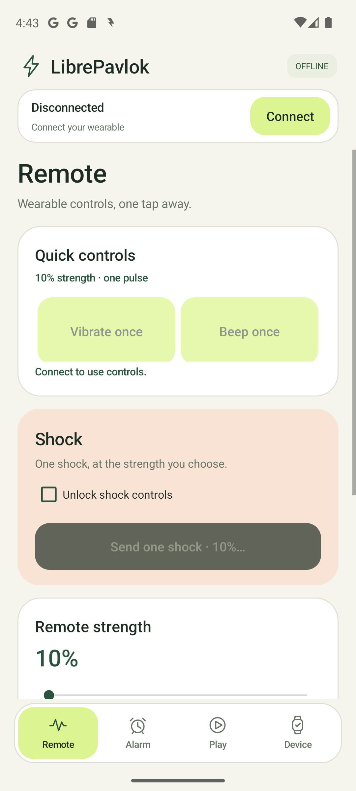
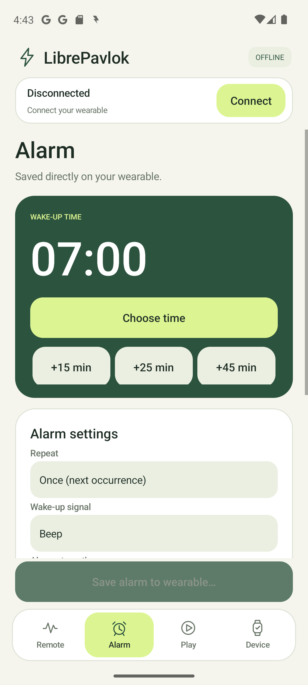
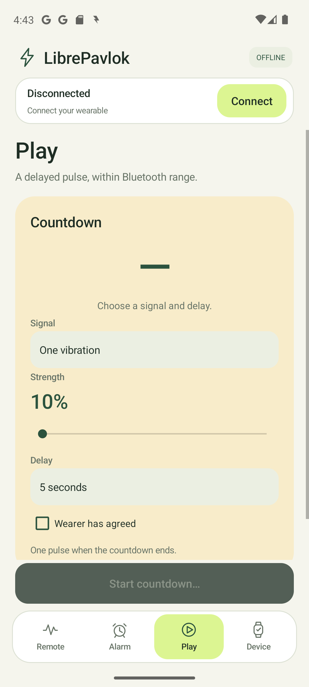

# LibrePavlok

An offline Android companion for the original Shock Clock / Pavlok-1 Bluetooth profile. Direct wearable controls, verified onboard alarm saving, and a cancellable Play countdown. No account, cloud, subscription, or Internet permission.

**[Download version 0.2.0](https://github.com/DerKernsen/LibrePavlok/releases/latest)** · [Changelog](CHANGELOG.md) · [Build and test](docs/development.md) · [Alarm protocol](docs/protocol.md)

<p>
  
  
  
</p>

## Everyday controls

| Screen | What it does |
| --- | --- |
| **Remote** | Large vibration and beep buttons, a single shock with confirmation, strength presets, last verified alarm, and Stop alarm. |
| **Alarm** | Time picker, 15/25/45-minute nap shortcuts, once or daily, vibration/beep/shock, independent strength, snooze, stop, and a fixed Save button. |
| **Play** | A delayed vibration or shock for an agreed-on joke. Choose a fixed or random delay, watch the countdown, and cancel from the fixed bottom action. |
| **Device** | Find/reconnect a wearable, battery and firmware, connection tools, alarm status, and local diagnostic export. |

Remote, Alarm and Play have separate, remembered strength settings. **Every strength control reaches 100%**, using the legacy device's ten-percent steps. Play has no additional intensity cap. Shock controls use an unlock and a concise confirmation. Play's shock option also asks for wearer agreement.

The connection and battery status stay above the content; navigation stays at the bottom. Alarm settings remain editable while disconnected. Saving reports success only after the wearable confirms both stored records, the selected slot and the armed state.

## Install and connect

1. Download `LibrePavlok-debug.apk` from [Releases](https://github.com/DerKernsen/LibrePavlok/releases/latest) or [dist](dist/LibrePavlok-debug.apk). Install on Android 6 or newer.
2. Wake the wearable and disconnect it from another app if necessary.
3. Tap **Connect**, then choose the device. Grant the Android Bluetooth permissions. Android 6–11 also needs Location permission and the system Location toggle for BLE scanning; LibrePavlok does not request location data.
4. LibrePavlok reads the device information and starts the matching local session. Use **Device** to inspect firmware or reconnect the last wearable.
5. Set an alarm on **Alarm** and tap **Save alarm to wearable…**. The confirmation shows the time, signal and strength. Saving replaces the existing wearable alarm list.

The supplied APK is locally debug-signed. Builds made with a different signing key cannot install as updates over it; see [development instructions](docs/development.md).

## Device compatibility and verification

| Device / firmware | Status |
| --- | --- |
| Legacy profile, model `Pavlok-1`, hardware `v2.0.0`, firmware `2.4.99` | Connected on a Mi 9T / Android 11. Two separate 100% beep tests fired with the app disconnected; the final production save also produced a firmware firing-state response. |
| Matching legacy profile with `2.4.x` or `A4.x.y` firmware | Encoders and version branches implemented; other hardware/firmware combinations need physical validation. |
| Pavlok 2 / Shock Clock 2, Pavlok 3 / Shock Clock 3, Shock Clock Max, Ring | Separate protocols; controls are not implemented in this release. |

The save function includes the original app's extra 23:59:59 record. It was missing in the unsuccessful one-record standalone test and present in the successful two-record tests. This establishes the working sequence on the tested wearable, but does not prove the firmware's internal reason. See [the alarm investigation](docs/alarm-investigation.md).

Same-day standalone beep firing is verified. Daily rollover, next-day one-shot execution, the helper record's midnight sound, scheduled shock firing and snooze behavior still need longer hardware tests. The app currently saves one user alarm plus that helper record. It stores local wall time, so timezone or DST changes require saving again. Play runs while its screen is active and connected; leaving it, pausing the app or losing the connection cancels the countdown. The app does not schedule phone alarms as a fallback.

## Build

The standalone Windows scripts use the installed Android SDK and Android Studio JDK; they download no build dependencies. Install Android API 35 and build-tools 35.0.0, then run:

```powershell
powershell.exe -NoProfile -ExecutionPolicy Bypass -File scripts/test-protocol.ps1
powershell.exe -NoProfile -ExecutionPolicy Bypass -File scripts/build-android.ps1
```

Use `-Sdk` and `-Jdk` to specify other tool locations. An Android Studio Gradle project is also included under `android/`. Full build, instrumentation and architecture instructions are in [docs/development.md](docs/development.md).

Release validation: **213 protocol checks, 21 countdown checks, 12 emulator UI checks**, signed APK verification, and screen inspection on the Mi 9T. UI QA dispatches no wearable commands. The alarm transaction is the previously hardware-verified 0.1.5 implementation; 0.2.0 changes its interface and independent strength selection.

## Research and contributing

LibrePavlok's implementation was written independently from packet layouts and behavior observed in two supplied old Android apps, REA/JADX inspection, public protocol projects, and device tests. Proprietary APKs, decompiled source, raw phone logs and signing keys are excluded from this repository.

- [Protocol reference](docs/protocol.md)
- [Why the standalone alarm started working](docs/alarm-investigation.md)
- [Contributing](CONTRIBUTING.md)

MIT license. See [LICENSE](LICENSE).
